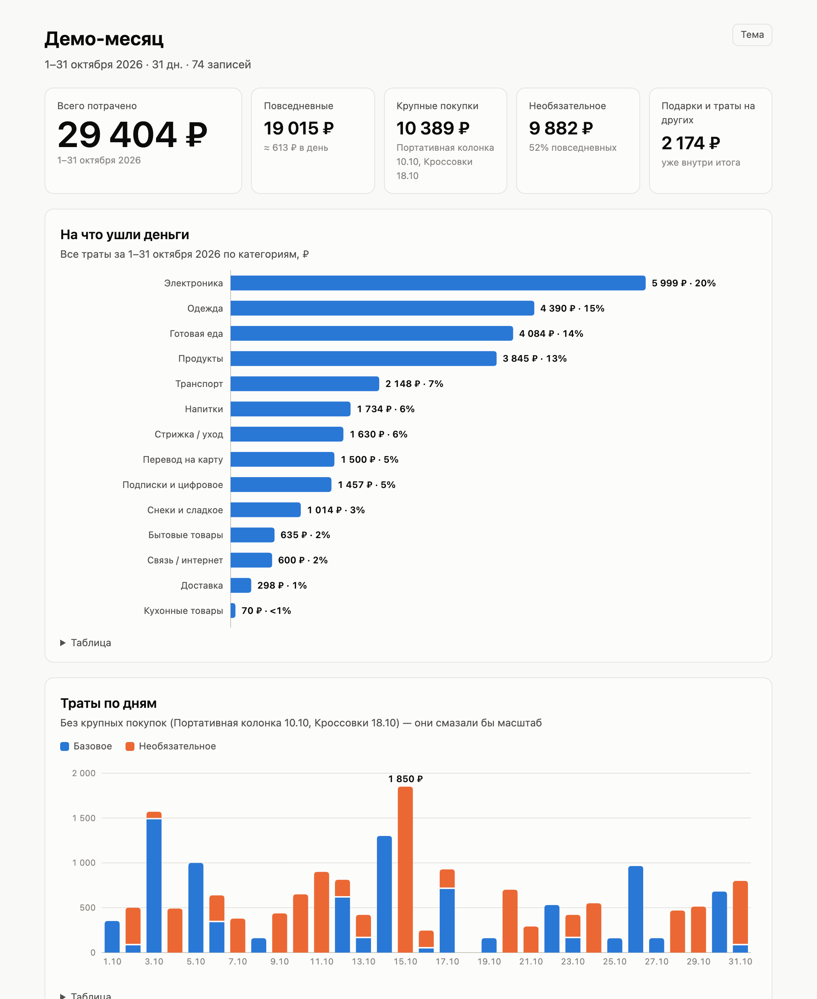

# claude-expense-tracker

**Учёт личных трат в Claude Code: платежи Яндекс Пэй, чеки Ленты и заказы Яндекс Еды сверяются с базой в Notion, а в конце месяца получается отчёт с графиками.**

*Personal expense tracking for Claude Code: Yandex Pay payments, Lenta receipts and Yandex Eda orders reconciled with a Notion database, plus a monthly report.*

Вы говорите Claude «разберём траты». Он сам смотрит свежие платежи по карте, находит те, что ещё не записаны, и предлагает, что это было. Вам остаётся ответить номерами. Позиции он раскладывает по строкам в Notion и сверяет итог с банком. Вести таблицу вручную не нужно.

[](docs/demo/report.png)

<sub>Отчёт построен по выдуманному месяцу из [`examples/demo-month.csv`](examples/demo-month.csv) с правилами из [`config.example.json`](plugins/expense-tracker/skills/expense-tracker/scripts/report/config.example.json); выводы — [`examples/demo-findings.html`](examples/demo-findings.html). Отчёт целиком: [скриншот](docs/demo/report.png); интерактивная версия: [`docs/demo/report.html`](docs/demo/report.html) (скачайте и откройте в браузере).</sub>

---

## Что умеет

- **Сверка платежей.** Берёт операции по карте Яндекс Пэй за период и сравнивает их с базой Notion. Показывает только то, что ещё не записано. Отказы (FAIL) и поступления в список не попадают.
- **Состав чеков.** Позиции из чеков Ленты (покупки в магазине по «Карте №1» и онлайн-заказы) и из заказов Яндекс Еды, включая магазины внутри Еды, подставляются автоматически. Весовые товары берутся по фактическому весу.
- **Догадки по мелким платежам.** Когда чека нет, Claude подбирает состав по прошлым ценам этого магазина (`guess_combo.py`) и помечает такую строку в «Детали».
- **Запись в Notion.** Одна строка соответствует одной позиции чека. Есть категория, тип, необходимость, магазин и количество. Подарки и покупки на двоих записываются отдельно.
- **Отчёт за месяц.** Самодостаточный HTML с графиками: группы трат, траты по дням, места, крупные покупки, необязательное, подарки и, если заданы правила, ваши привычки. Под графиками выводы и советы, где можно сэкономить.
- **Память о вас.** Claude запоминает, под каким названием ваш магазин виден в банке, что обычно значат переводы и какие у вас привычные покупки и цены. Всё это хранится в локальном `profile.md`, а не в репозитории.

## Как это выглядит

Пример диалога. Все данные выдуманы.

> **Вы:** разберём траты
>
> **Claude:** С 28 октября не записано 6 платежей:
>
> **31 октября**
>
> 1. −1 284 ₽ · Лента: чек найден, 9 позиций (молоко, курица 0,86 кг, хлеб, …)
> 2. −89 ₽ · Транспорт: проезд?
> 3. −412 ₽ · Пятёрочка: чека нет, состав по прошлым ценам: хлеб 59 + сыр 254 + молоко 99
>
> **30 октября**
>
> 4. −350 ₽ · перевод, Иван И.: за что?
> 5. −699 ₽ · Яндекс Еда: заказ из Перекрёстка, 5 позиций и доставка
> 6. −299 ₽ · подписка (холд, может измениться)
>
> **Вы:** 4 — обед в кафе, 6 не записывай, остальное да
>
> **Claude:** Записано 20 строк в «Расходы по товарам» на 2 834 ₽, с банком сходится. В «Где» добавлен вариант «Пятёрочка».

Отвечать можно как угодно: «да», «доверяю, добавь всё», «3 — это не продукты, а бытовое», «5 пропусти». До вашего ответа Claude ничего в Notion не пишет.

## Требования

| Что | Зачем |
|---|---|
| [Claude Code](https://code.claude.com/) | Здесь работают скиллы |
| Аккаунт Notion (бесплатного хватает) и вход в Claude Code аккаунтом claude.ai | В Notion живёт база трат. Коннекторы claude.ai доступны в Claude Code только при входе аккаунтом claude.ai, а не API-ключом или через Bedrock/Vertex |
| Notion-коннектор claude.ai | Чтение и запись базы трат. Подключается в claude.ai → Settings → Connectors. `/mcp` в Claude Code только показывает его и переавторизует, добавить им коннектор нельзя |
| [uv](https://docs.astral.sh/uv/) | Запускает скрипты с Playwright. Зависимости объявлены inline (PEP 723), отдельно ставить ничего не нужно |
| Python 3.9+ | `config.py`, `guess_combo.py`, `build_report.py`. Только стандартная библиотека, подойдёт системный `python3` на macOS (если его нет: `xcode-select --install`). Скриптам с браузером Python 3.10+ подбирает сам uv |
| Google Chrome (на Linux подойдёт и Chromium) | Отдельный профиль браузера для входа в банк, Ленту и Еду. Браузеры Playwright не скачиваются |
| macOS или Linux | На Linux нужен графический сеанс (X11 или Wayland): headless не используется |
| Карта Яндекс Пэй / Яндекс Банка | Источник платежей (кабинет bank.yandex.ru) |
| Аккаунт Ленты, Яндекс Еда | По желанию, чтобы видеть состав чеков и заказов |

## Установка

### Через маркетплейс (рекомендуется)

В сессии Claude Code:

```text
/plugin marketplace add homka122/claude-expense-tracker
/plugin install expense-tracker@claude-expense-tracker
```

То же самое из терминала:

```bash
claude plugin marketplace add homka122/claude-expense-tracker
claude plugin install expense-tracker@claude-expense-tracker
```

После установки перезапустите Claude Code. Скиллы появятся как `expense-tracker:expense-tracker`, `expense-tracker:expense-tracker-setup` и `expense-tracker:expense-report`.

Обновление:

```bash
claude plugin marketplace update claude-expense-tracker
claude plugin update expense-tracker@claude-expense-tracker
```

### Вручную (без маркетплейса)

Склонируйте репозиторий и сделайте симлинки трёх скиллов в `~/.claude/skills/`. Скиллы ссылаются друг на друга относительными путями, поэтому все три должны лежать рядом.

Перед этим проверьте `ls -la ~/.claude/skills/ | grep expense`: если там уже есть `expense-tracker*` и это не симлинки на этот репозиторий, переименуйте их. Не совмещайте ручную установку с установкой через маркетплейс: скиллы задублируются и будут перехватывать одни и те же фразы.

```bash
git clone https://github.com/homka122/claude-expense-tracker.git ~/claude-expense-tracker
mkdir -p ~/.claude/skills
for s in expense-tracker expense-tracker-setup expense-report; do
  ln -sfn ~/claude-expense-tracker/plugins/expense-tracker/skills/$s ~/.claude/skills/$s
done
```

Обновление: `git -C ~/claude-expense-tracker pull`.

## Первый запуск

Скажите Claude **«настрой учёт трат»**. Запустится скилл `expense-tracker-setup` и проведёт по шагам, проверяя каждый:

1. Проверит Python, `uv` и Chrome. Если чего-то нет, подскажет, как поставить.
2. Проверит Notion-коннектор.
3. Задаст несколько коротких вопросов: какими картами вы платите, где обычно покупаете, кому переводите и как отмечать подарки. Ещё спросит, нужны ли Лента и Еда.
4. Создаст страницу «Расходы» с базой «Расходы по товарам» по [схеме](plugins/expense-tracker/skills/expense-tracker/references/notion-schema.md). Если такая база у вас уже есть, подключит её. Названия можно поменять: база находится по ID из `config.json`.
5. Запишет data source и представление базы в `~/.expense-tracker/config.json`. Заведёт `profile.md` по [шаблону](plugins/expense-tracker/skills/expense-tracker/references/profile-template.md) и заполнит его вашими ответами.
6. С вашего согласия откроет окно Chrome, чтобы вы вошли в Яндекс ID и ввели PIN банка. Затем для проверки покажет 3 последние операции.
7. По желанию поможет войти в Ленту и проверит Яндекс Еду.

## Как пользоваться

Говорите обычными словами, скилл подхватит сам:

- «разберём траты», «сверь платежи за неделю», «что не записано с 20 октября»
- «запиши: кофе 180 в кофейне у работы»
- «что я покупал в Ленте в субботу?»
- «сколько я потратил на доставку в октябре?»
- «итоги месяца», «сделай отчёт за октябрь»
- «настрой учёт трат», «перелогинь банк»

Скрипты можно запускать и руками из каталога `scripts/` скилла `expense-tracker` (или просто попросите Claude выполнить команду):

- ручная установка: `~/claude-expense-tracker/plugins/expense-tracker/skills/expense-tracker/scripts/`;
- маркетплейс: `~/.claude/plugins/cache/claude-expense-tracker/expense-tracker/<версия>/skills/expense-tracker/scripts/`. Найти точный путь: `dirname "$(find ~/.claude/plugins -name ypay.py -path '*expense-tracker*' | head -1)"`.

```bash
uv run ypay.py -n 10                 # последние 10 операций
uv run ypay.py --since 2026-10-01 --json
uv run lenta.py shop --since 2026-10-01
uv run eda.py orders
python3 guess_combo.py 412 "Хлеб=59" "Сыр=254" "Молоко=99"
python3 config.py show
```

Код выхода `3` значит, что нужен вход: сессия банка истекла или вы не вошли в Ленту либо Еду. Подробнее в [docs/troubleshooting.md](docs/troubleshooting.md).

## Где хранятся личные данные

Всё личное лежит вне репозитория и вне каталога плагина, в `~/.expense-tracker/`. Путь меняется переменной `EXPENSE_TRACKER_HOME`.

```text
~/.expense-tracker/
├── config.json          # data source и представление базы Notion, часовой пояс, CDP-порт
├── profile.md           # что Claude узнал о вас: магазины, переводы, привычные покупки, правила
├── chrome-profile/      # отдельный профиль Chrome (cookies банка, Ленты, Еды)
├── ypay-feed-hash       # кэш operationId GraphQL-запроса банка
├── reports/             # выгрузки месяца (CSV), отчёты (HTML) и выводы к ним
└── report-config.json   # необязательные правила отчёта: привычки, порог крупных покупок
```

Другие переменные окружения:

- `EXPENSE_TRACKER_CDP_PORT` — порт отладки Chrome (по умолчанию 9223);
- `EXPENSE_TRACKER_CHROME` — свой путь к Chrome или Chromium;
- `EXPENSE_TRACKER_CHROME_ARGS` — дополнительные флаги Chrome, например `--ozone-platform=x11` на Wayland.

Сами траты хранятся только в вашей базе Notion.

## Приватность и ограничения

- **Неофициальные API.** Банк, Лента и Еда читаются через те же запросы, что делают их сайты из вашего браузера. Публичного API у них нет. Сайт может поменяться, и скрипт сломается. Для банка смену запроса (operationId) скрипт подхватывает сам.
- **Сессия банка живёт около 15 минут.** Потом нужен PIN или код. Claude спросит вас и только после ответа откроет окно для входа.
- **Данные платежей уходят в модель.** Суммы, магазины и названия позиций Claude видит, иначе он не сможет их разобрать. Лишнего скилл не печатает. Токены, cookies и заголовки авторизации не выводятся никогда.
- **Без обхода защиты.** Используется обычный Chrome с вашим входом. Headless-режим и подмена User-Agent не применяются. Окно держится свёрнутым и разворачивается только для входа.
- **Профиль Chrome не переносится** между компьютерами. На новой машине нужно войти заново.

Подробно: [docs/privacy.md](docs/privacy.md).

## Структура репозитория

```text
.claude-plugin/marketplace.json          маркетплейс «claude-expense-tracker»
plugins/expense-tracker/
├── .claude-plugin/plugin.json
└── skills/
    ├── expense-tracker/                 сверка платежей с Notion и запись
    │   ├── SKILL.md
    │   ├── references/                  схема базы, правила учёта, шаблоны профиля и выводов
    │   └── scripts/                     config, browser, ypay, lenta, eda, guess_combo, report/
    ├── expense-tracker-setup/SKILL.md   первичная настройка
    └── expense-report/SKILL.md          отчёт за месяц
examples/demo-month.csv                  выдуманный месяц для демо-отчёта
examples/demo-findings.html              выводы к демо-отчёту
docs/                                    как устроено, приватность, проблемы, демо (docs/demo/)
```

## Документация

- [Как это работает](docs/how-it-works.md): архитектура, поток «платёж → запись», форматы данных
- [Приватность](docs/privacy.md): что где хранится, что уходит в модель, как всё удалить
- [Если что-то не работает](docs/troubleshooting.md): код 3, Chrome, устаревший operationId, квота Notion, Linux

## Лицензия

[MIT](LICENSE) © 2026 homka122

## Дисклеймер

Проект неофициальный. Он не связан с ООО «Яндекс», Яндекс Банком, Яндекс Пэй, Яндекс Едой, ООО «Лента», Notion Labs и Anthropic и не одобрен ими. Названия сервисов принадлежат их владельцам. Вы используете скрипты на свой риск и в рамках правил этих сервисов. Проект ничего не оплачивает и не переводит: он только читает историю операций, чеков и заказов.
